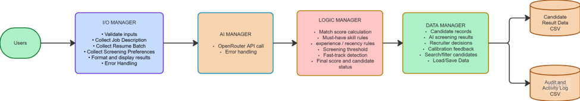

# Project Details
## AI-powered Resume Screener

This document describes the final agreed scope and the behaviour implemented in
the application. The README contains the commands for running the project and tests.

**Lab-P2 GROUP 2**

**Team Members:**
- Kaushik
- Samuel
- Roy
- Jereson
- Melvyn
- Ritchie

**Repository URL:** https://github.com/GovindarajKaushik/Group1-ResumeScreener.git

---

## 1. Problem Statement and Target Users

### Problem Statement

Hiring managers and HR teams spend hours manually reading through unstructured resumes to extract key qualifications and rank candidates. Simple keyword searches often fail because they miss context or misinterpret candidate experience, resulting in huge time consumption.

HR recruiters often receive a high volume of resumes for one position and have to review each manually. They need to extract the relevant information from each resume and match it to the requirements specified in the job description. This process is tedious and time-consuming since every resume has to be read and understood even with an Applicant Tracking System (ATS). Keyword search in resumes also does not work well, as it favours applicants who use the same terms as the job description. This leads to two problems:

1. Qualified applicants with slightly different wording than the job description may get filtered out.
2. The shortlisting process becomes inconsistent between reviewers.

Our application solves this by allowing users to quickly extract relevant information about candidates and compare it to a specific position's requirements using an AI-based approach. This enables users to evaluate applicants more efficiently and thoroughly since it goes beyond the simple keyword matching used by current applications in the market. This helps users identify qualified candidates who would have otherwise been overlooked due to differences in wording or human error.

### Target Users

Recruiters, hiring managers, and talent acquisition teams.

The primary users for this application are corporate recruiters, hiring managers, and talent acquisition teams who are responsible for incoming applications for one or more open roles. These users typically work with a high volume of resumes per posting and need to make fast but defensible shortlisting decisions. They enter job requirements through the terminal, select a folder of resumes, and receive ranked results with evidence and scoring notes. Saved CSV files can be opened in Excel before optional review through the application.

---

## 2. User Inputs

- **Job Description:** job title, required skills, minimum years of experience, education requirements, and preferred skills, entered through terminal prompts.
- **Candidate Resumes:** a selected folder containing PDF or DOCX files. Additional folders can be entered during input collection to add resumes or retry failed extraction.
- **Screening Preference:** minimum qualifying score from 0 to 100, with a default of 60. Criterion weights are fixed at 50% skills, 30% experience, and 20% education.
- **Optional Human Review:** shortlist, reject, or skip a scored candidate after the batch is saved. Review proceeds in CSV order, with an optional jump to a candidate ID before returning to the paused position.
- **Job Deletion:** select a saved job and explicitly confirm deletion of the job and all its linked candidate CSV records.

The current menu does not provide job-description document uploads, adjustable
criterion weights, feedback ratings, or later re-entry of saved failed candidates.
There is no configured maximum resume file size.

---

## 3. Use of AI

Each readable resume accepted during input collection is sent as processed text
to OpenRouter. The prompt asks the model to compare resume qualifications with
the job requirements semantically, including equivalent wording. It combines:

- **Job Requirements:** title, required/preferred skills, minimum experience, and education requirements entered by the user.
- **Processed Resume Text:** plain text extracted and cleaned by the input/output manager, with the supported personal-information redactions applied.
- **Screening Instructions:** a system prompt specifying resume-based assessment, skill evidence, and a structured JSON response.

The minimum qualifying score and fixed scoring weights are applied locally by
`logic_manager.py`; they are not sent to the model. The AI's overall score is
stored for comparison, while the application calculates its own final score.

### AI-Generated Outputs

- **Skills:** required/preferred skill entries with presence flags, last-used years when available, and evidence text.
- **Criterion Scores:** experience and education scores from 0 to 100.
- **Overall AI Score:** a separate model-generated score from 0 to 100.
- **Assessment:** an overall summary and low, medium, or high confidence.

The model is instructed to provide short exact resume excerpts as evidence.
The application checks evidence types and awards skill points only when evidence
is nonempty; it does not independently verify that each excerpt occurs in the
resume or proves the qualification. Recruiters should review the evidence.

---

## 4. Business Rules

| Business Rule | Description |
|---|---|
| Final Score | Combine the calculated skills score (50%), AI experience score (30%), and AI education score (20%), then apply the must-have bonus or missing-skill cap. Keep the result between 0 and 100 and round it to one decimal place. |
| Score Routing | A final score at or above the user's threshold receives `SHORTLIST`; a lower score receives `SECONDARY_REVIEW`. Both remain available for human review. Routing uses the calculated final score, not the AI overall score. |
| Skill Weighting | Each required skill has weight 1 and each preferred skill has weight 0.5 in the skills calculation. A present skill earns points only with nonempty evidence. |
| Must-Have Bonus | Add 5 points when at least one required skill is specified and all required skills are reported present with nonempty evidence. |
| Missing Required Skills | A required skill reported absent, omitted, or not matched by name is treated as missing. If any required skill is missing, cap the final score at 59. Routing still uses the user's chosen threshold. |
| Missing Evidence | A skill reported present without evidence earns no skill points. For a required skill, this also prevents the must-have bonus and fast-track tag, but does not by itself reject the response or apply the missing-skill cap. |
| Recency of Experience | Halve a supported skill's earned points when its last-used year is at least 5 years before the current year. Unknown dates receive no recency penalty and are noted for review. |
| Fast-Track | Tag candidates with a final score of at least 90, each criterion score of at least 80, no missing or unsupported required skills, and medium or high AI confidence. |
| AI Score Comparison | If the AI overall score differs from the weighted score before bonus/cap by at least 25 points, add a note recommending human review. Low confidence also adds a review note. |
| Privacy Processing | Send only processed text, not the original document or its images. Remove labelled personal-detail lines and replace recognised emails and phone numbers. Unlabelled names, addresses, and other identifying details may remain; complete anonymisation is not guaranteed. |
| Human Confirmation | Store system recommendations separately from recruiter decisions. New candidates default to `pending`; only an explicit review action sets `shortlisted` or `rejected`. Skipping preserves the existing decision. Failed or unscored records cannot receive a decision through the review menu. |
| Audit Logging | Record UTC timestamps with an explicit `+00:00` offset for job creation, candidate result saving/updating, recruiter decision changes, and confirmed job deletion. A deletion entry records the job ID and affected candidate IDs. Viewing, skipped decisions, cancellations, and technical retries are not logged. |
| Job Deletion | Delete only the selected job ID and candidate CSV records linked to that ID, including failed records. Confirmation is required. Other jobs, original resume files, audit history, and optional debug JSON remain. Older candidate records without a job ID are not assigned to or deleted with another job. |
| ID Allocation | New job IDs increment from the highest ID currently in jobs.csv, starting at J001 if no jobs remain. Candidate IDs also check retained audit history to avoid reuse. Audit history remains even when a deleted job ID is reused. |
| Input Validation | Accept only regular, nonempty PDF/DOCX files with readable text remaining after processing. Report rejected files and allow folder re-entry during collection while retaining accepted resumes. Validate minimum experience as finite and nonnegative, and the qualifying score within 0 to 100. No maximum file-size limit is configured. |
| API Failure Handling | Allow immediate retries during the active batch for connection, timeout, rate-limit, and server failures. Invalid responses and unresolved failures are stored as `RE_ENTRY` with blank scores and a reason. `RE_ENTRY` is a failure status, not a later-resume feature. |
| Batch Cancellation | Ctrl+C or EOF during screening or retry choices cancels the whole batch before job, candidate, audit, or debug data is written. Start a new batch to screen the folder again. Choosing not to retry instead finishes the batch and saves its successes and failures. |

For screening batches, cancellation applies before saving begins. Once the saving phase starts, files
already written are not rolled back. CSV storage and audit logging are separate
operations; errors are reported, but a CSV write can succeed before its audit
entry fails.

Job deletion writes the filtered candidate CSV before the jobs CSV. If writing
the jobs CSV fails, the application attempts to restore the original candidate
rows. A restoration failure or an audit failure is reported so the user can check
the saved files; the two CSVs and audit log are not a single atomic transaction.

Results are stored in `data/jobs.csv`, `data/candidate_results.csv`, and
`data/audit_log.csv`. `data/resume_results.json` is debug output written after
the batch finishes; scoring does not depend on that file, and debug write failures
produce a warning. With Docker, the mounted `data/` folder keeps these files on
the host computer.

New storage timestamps use ISO 8601 UTC, for example `2026-10-13T08:00:00+00:00`.
Older stored timestamps are preserved as recorded; they are not converted or
assigned a timezone retrospectively.
The menu displays recognised dates readably, such as `13 Oct 2026, 08:00:00 UTC`.
Historical dates without a timezone are displayed without a timezone label;
unrecognised date text remains visible as recorded.

---

## 5. High-Level Architecture

